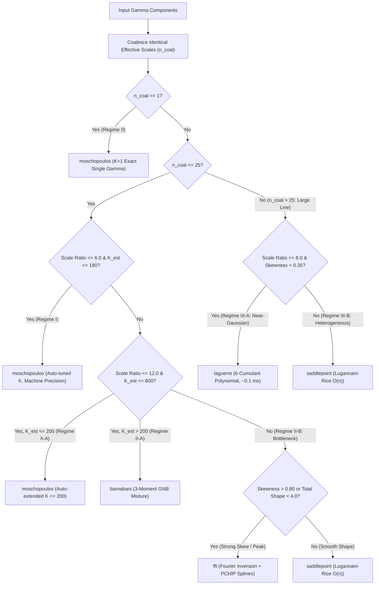

# Technical Note: Computational Methods for Linear Combinations of Independent Gamma Random Variables

**Package**: `gamma-linear-combination` (`toolbox.stats.GammaLinearCombination`)  
**Author**: Liam Hsieh  

---

## 1. Problem Formulation

Let $X_1, X_2, \dots, X_n$ be mutually independent Gamma distributed random variables with shape parameters $\alpha_i > 0$, scale parameters $\beta_i > 0$ (or rate parameters $\lambda_i = 1/\beta_i$), and optional minimum location shifts $\text{loc}_i \ge 0$:

$$f_{X_i}(x) = \frac{(x - \text{loc}_i)^{\alpha_i - 1} \exp\!\left(-\frac{x - \text{loc}_i}{\beta_i}\right)}{\beta_i^{\alpha_i} \Gamma(\alpha_i)}, \qquad x > \text{loc}_i$$

Given positive real weights $c_1, \dots, c_n \in \mathbb{R}_+$, we seek the probability density function (PDF) $f_Y(y)$, cumulative distribution function (CDF) $F_Y(y) = \Pr(Y \le y)$, and quantile function (percentile / PPF) $F_Y^{-1}(q)$ of the linear combination:

$$Y = \sum_{i=1}^n c_i X_i = \sum_{i=1}^n Z_i + L$$

where $L = \sum_{i=1}^n c_i \text{loc}_i$ is the aggregate location shift, and each scaled component $Z_i = c_i(X_i - \text{loc}_i) \overset{\text{ind.}}{\sim} \Gamma(\alpha_i, \tilde{\beta}_i)$ has effective scale:
- $\tilde{\beta}_i = c_i \beta_i$ under **shape–scale** parameterization (`parameterization="scale"`), or
- $\tilde{\beta}_i = c_i / \lambda_i$ under **shape–rate** parameterization (`parameterization="rate"`, since $c_i X_i \sim \Gamma(\alpha_i, \lambda_i / c_i)$).

The exact Cumulant Generating Function (CGF) of the unshifted sum $Y - L = \sum_{i=1}^n Z_i$ is:

$$K(t) = \ln M(t) = -\sum_{i=1}^n \alpha_i \ln(1 - \tilde{\beta}_i t), \qquad t < \frac{1}{\max_i \tilde{\beta}_i}$$

and its exact $r$-th cumulant ($r \ge 1$) is additive in $O(n)$ closed form:

$$\kappa_r = (r - 1)! \sum_{i=1}^n \alpha_i \tilde{\beta}_i^r$$

---

## 2. Introduction to Each Implemented Method

Because no simple closed-form elementary expression exists for the density or CDF of $\sum_{i=1}^n Z_i$ when the effective scales $\tilde{\beta}_i$ are distinct, `GammaLinearCombination` provides **10 computational options** spanning exact infinite series, discrete mixture approximations, orthogonal polynomial expansions, asymptotic saddlepoint inversions, Fourier transforms, moment matching, and Monte Carlo simulation.

---

### Method 1: Exact Moschopoulos Gamma-Series (`method="moschopoulos"`, Default)
- **Primary Reference**: Moschopoulos, P. G. (1985). *"The distribution of the sum of independent gamma random variables."* *Annals of the Institute of Statistical Mathematics*, 37(1), 541–544.
- **Mathematical Idea**:
  Let $\beta_1 = \min_{1 \le i \le n} \tilde{\beta}_i$ and $\rho = \sum_{i=1}^n \alpha_i$. Factoring $(1 - \beta_1 t)^{-\rho}$ from the MGF yields an exact representation of $f_Y(y)$ and $F_Y(y)$ as a **single infinite mixture of Gamma distributions** with common scale $\beta_1$:

  $$f_Y(y) = C \sum_{k=0}^{\infty} \delta_k \, g(y - L; \, \rho + k, \beta_1), \qquad F_Y(y) = C \sum_{k=0}^{\infty} \delta_k \, P\!\left(\rho + k, \, \frac{y - L}{\beta_1}\right)$$

  where $g(u; a, \beta_1) = \frac{u^{a-1}e^{-u/\beta_1}}{\Gamma(a)\beta_1^a}$, $P(a, z) = \frac{1}{\Gamma(a)}\int_0^z t^{a-1}e^{-t}\,dt$ is the regularized lower incomplete gamma function, and the coefficients are computed recursively via:

  $$C = \prod_{i=1}^n \left(\frac{\beta_1}{\tilde{\beta}_i}\right)^{\alpha_i}, \qquad \gamma_k = \frac{1}{k} \sum_{i=1}^n \alpha_i \left(1 - \frac{\beta_1}{\tilde{\beta}_i}\right)^k, \qquad \delta_0 = 1, \quad \delta_k = \frac{1}{k} \sum_{j=1}^k j \gamma_j \delta_{k-j}$$

- **Strengths**: Machine-precision exactness ($\sim 10^{-13}$ error) with rigorous truncation bounds.
- **Limitations**: The geometric decay rate of $\gamma_k$ is governed by $b_{\max} = 1 - \beta_1 / \beta_{\max}$. When the scale ratio $\beta_{\max}/\beta_1$ is very large ($\gg 20\times$), the mode of the mixture weights shifts to $k^* = \sum \alpha_i (\tilde{\beta}_i/\beta_1 - 1)$, requiring more terms.

---

### Method 2: Moschopoulos Series + Numerical Quadrature (`method="moschopoulos_quad"`)
- **Primary Reference**: Moschopoulos (1985) PDF paired with adaptive Gauss–Kronrod numerical integration (`scipy.integrate.quad`).
- **Mathematical Idea**: Evaluates $f_Y(y)$ using the Moschopoulos series and computes $F_Y(y) = \int_L^y f_Y(u)\,du$ via adaptive numerical quadrature.
- **Strengths**: Direct textbook verification of the integral of the PDF.
- **Limitations**: $100\times$ to $500\times$ slower for CDF and quantile evaluations than the incomplete-gamma recurrence in `method="moschopoulos"`.

---

### Method 3: Barnabani Generalized Negative Binomial Mixture (`method="barnabani"`)
- **Primary References**:
  - Vellaisamy, P., & Upadhye, N. S. (2009). *"On the sums of compound negative binomial and gamma random variables."* *Journal of Applied Probability*, 46(1), 272–283.
  - Barnabani, M. (2017). *"An approximation to the convolution of gamma distributions."* *Communications in Statistics - Simulation and Computation*, 46(1), 331–343.
  - Hu, C., Pozdnyakov, V., & Yan, J. (2020). *"Density and Distribution Evaluation for Convolution of Independent Gamma Variables."* *Computational Statistics*, 35, 1349–1370 (R package `coga`).
- **Mathematical Idea**:
  Vellaisamy & Upadhye (2009) observed that the normalized Moschopoulos weights $w_k = C \delta_k$ define the exact probability mass function (PMF) of a discrete random variable $K = \sum_{i=2}^n \text{NB}(\alpha_i, 1 - \beta_1/\tilde{\beta}_i)$ on $\{0, 1, 2, \dots\}$ with exact cumulants:

  $$\mu = \sum_{i=1}^n \alpha_i \left(\frac{\tilde{\beta}_i}{\beta_1} - 1\right), \quad \mu_2 = \sum_{i=1}^n \alpha_i \left(\frac{\tilde{\beta}_i}{\beta_1}\right)^2\left(1 - \frac{\beta_1}{\tilde{\beta}_i}\right), \quad \mu_3 = \sum_{i=1}^n \alpha_i \left(\frac{\tilde{\beta}_i}{\beta_1}\right)^3\left(1 - \frac{\beta_1}{\tilde{\beta}_i}\right)\left(2 - \frac{\beta_1}{\tilde{\beta}_i}\right)$$

  Instead of executing the $O(K^2)$ recursive convolution for $\delta_k$, **Barnabani (2017)** approximates $\Pr(K = k)$ in closed form using Jain & Consul's (1971) 3-parameter **Generalized Negative Binomial distribution $\text{GNB}(k; r, p, b)$** matched to $(\mu, \mu_2, \mu_3)$ when $A = \frac{(\mu \mu_3 - 3\mu_2^2)^2}{\mu \mu_2^3} - 2 \ge 2$ (and standard 2-parameter $\text{NB}(k; r, p)$ when $A < 2$, which is **exact** when $n = 2$):

  $$w_k \approx \frac{r}{r + b k} \binom{r + b k}{k} p^k (1 - p)^{r + b k - k}$$

- **Strengths**: Eliminates the $O(K^2)$ recurrence for $\delta_k$, reducing initialization complexity from $O(nK + K^2)$ to **$O(n + K)$** ($15\times$ faster initialization at $n = 100$) while achieving $\sim 10^{-5}$ to $10^{-6}$ CDF accuracy.

---

### Method 4: Ha & Provost Generalized Laguerre Polynomial Expansion (`method="laguerre"`)
- **Primary References**:
  - Provost, S. B. (2005). *"Moment-based density approximations."* *The Mathematica Journal*, 9(4), 727–756.
  - Ha, H.-T., & Provost, S. B. (2013). *"An accurate approximation to the distribution of a linear combination of non-central chi-square random variables."* *REVSTAT Statistical Journal*, 11(3), 231–254.
- **Mathematical Idea**:
  Rather than expanding around the minimum scale $\beta_1$, this method expands around the **Welch–Satterthwaite baseline Gamma density** $g(u; \alpha_0, \beta_0)$ (where $\alpha_0 = \kappa_1^2/\kappa_2$ and $\beta_0 = \kappa_2/\kappa_1$ match the exact mean and variance) using generalized Laguerre polynomials $L_k^{(\alpha_0 - 1)}(z)$ with $z = (y - L)/\beta_0$:

  $$f_Y(y) \approx g(y - L; \, \alpha_0, \beta_0) \left[ 1 + \sum_{k=3}^6 c_k L_k^{(\alpha_0 - 1)}(z) \right]$$

  To avoid catastrophic cancellation when computing polynomial moments at large $\alpha_0$, our implementation derives $\mu_k^L = \mathbb{E}[L_k^{(\alpha_0 - 1)}(Z)]$ directly from the **cumulant-excess generating function** $d_r = (\tilde{\kappa}_r - (r-1)!\alpha_0)/r!$ ($r = 3, \dots, 6$):

  $$\sum_{k=0}^\infty \mu_k^L u^k = \exp\!\left(\sum_{r=3}^\infty d_r (-u)^r (1 - u)^{-r}\right), \qquad c_k = \frac{k!}{(\alpha_0)_k} \mu_k^L$$

  Furthermore, by Rodrigues' formula, the CDF has an **exact closed-form finite expression** requiring only a single incomplete gamma evaluation:

  $$F_Y(y) \approx P(\alpha_0, z) + \frac{z^{\alpha_0} e^{-z}}{\Gamma(\alpha_0)} \sum_{k=3}^6 \frac{c_k}{k} L_{k-1}^{(\alpha_0)}(z)$$

- **Strengths**: Matches the exact first **6 cumulants** ($\kappa_1, \dots, \kappa_6$) in $O(n)$ setup and $O(1)$ query time ($\sim 0.05\text{ ms}$ for 100 CDF points), outperforming 2-moment and 3-moment approximations by $10\times$–$40\times$ on moderate scale ratios.
- **Limitations**: Like Gram–Charlier/Edgeworth expansions, high-order polynomial corrections can oscillate when skewness is extreme ($\beta_{\max}/\beta_{\min} \gg 20$ with small $\alpha_i$).

---

### Method 5: Daniels & Lugannani–Rice Saddlepoint Approximation (`method="saddlepoint"`)
- **Primary References**:
  - Daniels, H. E. (1954). *"Saddlepoint approximations in statistics."* *The Annals of Mathematical Statistics*, 25(4), 631–650.
  - Lugannani, R., & Rice, S. (1980). *"Saddle point approximation for the distribution of the sum of independent random variables."* *Advances in Applied Probability*, 12(2), 475–490.
- **Mathematical Idea**:
  For each target value $u = y - L > 0$, solves the strictly convex, monotonic saddlepoint equation $K'(\hat{t}) = \sum_{i=1}^n \frac{\alpha_i \tilde{\beta}_i}{1 - \tilde{\beta}_i \hat{t}} = u$ for $\hat{t} \in (-\infty, 1/\beta_{\max})$ via safeguarded Newton–Raphson, then evaluates:
  - **Daniels' PDF**: $\hat{f}_Y(y) \propto \frac{1}{\sqrt{2\pi K''(\hat{t})}} \exp\!\big(K(\hat{t}) - \hat{t} u\big)$
  - **Lugannani–Rice CDF**: $\hat{F}_Y(y) = \Phi(w) + \phi(w)\left(\frac{1}{w} - \frac{1}{v}\right)$, where $w = \text{sgn}(\hat{t})\sqrt{2(\hat{t} u - K(\hat{t}))}$ and $v = \hat{t}\sqrt{K''(\hat{t})}$.
- **Strengths**: Completely insensitive to the scale ratio $\beta_{\max}/\beta_{\min}$; achieves $< 0.05\%$ error in the body and extreme tails ($P99.9$) in $O(n)$ time.

---

### Method 6: Characteristic Function Fourier / Gil–Pelaez Inversion (`method="fft"`)
- **Primary Reference**: Gil-Pelaez, J. (1951). *"Note on the inversion theorem."* *Biometrika*, 38(3–4), 481–482.
- **Mathematical Idea**:
  Evaluates the exact Characteristic Function $\varphi(t) = M(it) = \prod_{k=1}^n (1 - i\tilde{\beta}_k t)^{-\alpha_k}$ on a frequency grid and applies Fourier / Gil–Pelaez inversion:

  $$f_Y(y) = \frac{1}{\pi} \int_0^\infty \text{Re}\!\left[e^{-it(y-L)} \varphi(t)\right] dt, \qquad F_Y(y) = \frac{1}{2} - \frac{1}{\pi} \int_0^\infty \text{Im}\!\left[\frac{e^{-it(y-L)} \varphi(t)}{t}\right] dt$$

  to construct cached, monotonic PCHIP cubic splines for PDF, CDF, and inverse CDF (PPF).
- **Strengths**: Immune to large scale ratios $\beta_{\max}/\beta_{\min}$; after a $\sim 20\text{ ms}$ one-time precomputation, subsequent PDF, CDF, and quantile queries execute in **microseconds** ($O(1)$ per point).

---

### Method 7: Three-Moment Skewness-Matched Shifted Gamma (`method="moment_matching"`)
- **Mathematical Idea**: Matches the exact first three cumulants $(\kappa_1, \kappa_2, \kappa_3)$ with a single shifted Gamma (Pearson Type III) distribution $\Gamma(\alpha_{\text{eff}}, \text{loc}_{\text{eff}}, \beta_{\text{eff}})$:

  $$\beta_{\text{eff}} = \frac{\kappa_3}{2\kappa_2}, \qquad \alpha_{\text{eff}} = \frac{\kappa_2}{\beta_{\text{eff}}^2} = \frac{4}{\gamma_1^2}, \qquad \text{loc}_{\text{eff}} = L + \kappa_1 - \alpha_{\text{eff}} \beta_{\text{eff}}$$

- **Strengths**: Zero-overhead $O(n)$ setup and instant $O(1)$ closed-form `.pdf()`, `.cdf()`, and `.percentile()`.

---

### Method 8: Two-Moment Welch–Satterthwaite Approximation (`method="welch_satterthwaite"`)
- **Primary References**: Satterthwaite, F. E. (1946), *Biometrics Bulletin*; Welch, B. L. (1947), *Biometrika*.
- **Mathematical Idea**: Matches exact mean $\kappa_1$ and variance $\kappa_2$ with a single unshifted Gamma $\Gamma(\alpha_{\text{eff}}, \beta_{\text{eff}})$ shifted by $L$, where $\alpha_{\text{eff}} = \kappa_1^2/\kappa_2$ and $\beta_{\text{eff}} = \kappa_2/\kappa_1$.

---

### Methods 9 & 10: Empirical Monte Carlo (`method="monte_carlo"`) & Fitted Gamma Metamodel (`method="metamodel"`)
- **Mathematical Idea**: Draws $N_{\text{sim}}$ independent realizations $Y^{(m)} = \sum_{i=1}^n c_i X_i^{(m)} + L$ and evaluates either the Empirical CDF / Gaussian KDE (`"monte_carlo"`) or fits a 3-parameter shifted Gamma via maximum likelihood (`"metamodel"`).

---

## 3. Engineering Optimizations for Exact Moschopoulos Evaluation

When implementing Moschopoulos's (1985) exact algorithm in Python/NumPy, naive implementations suffer from three severe engineering bottlenecks:
1. **Float64 Underflow of $C$**: For $n \ge 100$ segments, $C = \prod_{i=1}^n (\beta_1/\tilde{\beta}_i)^{\alpha_i}$ frequently falls below $10^{-308}$, underflowing IEEE-754 double precision to `0.0`.
2. **Repeated Incomplete Gamma Calls**: Evaluating $F_Y(y) = \sum_{k=0}^K w_k P(\rho + k, z)$ across $M$ query points invokes Cephes `scipy.special.gammainc` $M \times (K + 1)$ times.
3. **Slow Numerical Root-Finding for Quantiles**: Calling generic `brentq` on $F_Y(y) - q = 0$ requires 12–15 CDF evaluations per quantile.

We resolved all three bottlenecks via four software engineering optimizations in [`MoschopoulosEngine`](file:///c:/Users/liamh/projects/gamma-linear-combination/src/gamma_linear_combination/engines.py#L223-L433):

1. **Incomplete-Gamma Forward Recurrence** *(Abramowitz & Stegun 6.5.21; Hu, Pozdnyakov, & Yan 2020)*:
   Using the exact identity:

   $$P(a + 1, z) = P(a, z) - \frac{z^a e^{-z}}{\Gamma(a + 1)}, \qquad p_{a+1}(z) = p_a(z) \cdot \frac{z}{a + 1}$$

   we call `scipy.special.gammainc` **only once** at $a_0 = \rho + k_{\min}$ and propagate all subsequent incomplete gamma terms via simple floating-point arithmetic, speeding up exact CDF evaluation by **$3.5\times$ to $13\times$**.
2. **Dynamic Exponent-Rescaled BLAS Recurrence**:
   Computes $\delta_k = \frac{1}{k}\sum_{j=1}^k (j\gamma_j)\delta_{k-j}$ using native C/BLAS `np.dot` in float64 and rescales $\delta_{0..k}$ by $10^{-200}$ (accumulating $+200 \ln 10$ into `log_scale_offset`) whenever $\delta_k > 10^{200}$. This preserves full BLAS speed while preventing overflow/underflow for arbitrary $n$.
3. **Active Support Window Trimming $[k_{\min}, k_{\max}]$ & Automatic $K_{\text{mix}}$ Moment Sizing**:
   Uses the exact mean $\mu_K = \kappa_1/\beta_1 - \rho$ and standard deviation $\sigma_K = \sqrt{\kappa_2/\beta_1^2 - \rho}$ of the discrete weight distribution to automatically size $K$ and trims indices where $w_k < 10^{-15} \max(w_k)$.
4. **Scale Coalescing & Safeguarded Newton–Raphson Quantiles**:
   Merges identical effective scales $\tilde{\beta}_i$ prior to expansion and uses analytical derivative $F'_Y(y) = f_Y(y)$ warm-started from the 3-moment Pearson III quantile to converge `.percentile(q)` in 3–4 iterations.

---

## 4. Empirical Comparison Across Regimes

The tables below report measured performance on 100 PDF points, 100 CDF points, and 5 quantiles ($P10, P50, P90, P95, P99$):

### Regime I: Moderate Scale Spread ($n = 4$ Weighted Segments, $\beta_{\max}/\beta_{\min} = 2.25\times$)

| Method | Init (ms) | PDF (ms) | CDF (ms) | PPF (ms) | PDF Max Abs Err | CDF Max Abs Err | PPF Max Rel Err (%) |
| :--- | ---: | ---: | ---: | ---: | ---: | ---: | ---: |
| **`moschopoulos`** | 0.25 | 0.09 | **0.17** | 3.98 | **$4.68 \times 10^{-14}$** | **$7.81 \times 10^{-13}$** | **0.0000%** |
| **`moschopoulos_quad`** | 0.21 | 0.09 | 74.65 | 19.46 | $4.68 \times 10^{-14}$ | $7.80 \times 10^{-13}$ | 0.0000% |
| **`barnabani`** | 0.19 | 0.16 | 0.19 | 4.72 | $4.89 \times 10^{-6}$ | $1.69 \times 10^{-5}$ | 0.0016% |
| **`laguerre`** | **0.07** | 0.17 | **0.05** | **1.15** | $2.40 \times 10^{-5}$ | $5.98 \times 10^{-5}$ | **0.0106%** |
| **`saddlepoint`** | 0.04 | 3.85 | 3.74 | 6.96 | $6.35 \times 10^{-4}$ | $2.68 \times 10^{-4}$ | 0.0244% |
| **`fft`** | 19.98 | 0.12 | **0.05** | **0.03** | $9.95 \times 10^{-7}$ | $3.40 \times 10^{-7}$ | **0.0000%** |
| **`moment_matching`** | 0.06 | 0.13 | 0.08 | 0.07 | $2.67 \times 10^{-4}$ | $8.51 \times 10^{-4}$ | 0.0526% |
| **`welch_satterthwaite`** | 0.03 | 0.06 | 0.07 | 0.06 | $6.14 \times 10^{-4}$ | $2.21 \times 10^{-3}$ | 0.4367% |
| **`monte_carlo`** | 2.93 | 14.60 | 0.13 | 0.25 | $1.92 \times 10^{-3}$ | $5.33 \times 10^{-3}$ | 0.1968% |
| **`metamodel`** | 2.26 | 0.14 | 0.08 | 0.06 | $3.62 \times 10^{-3}$ | $1.50 \times 10^{-2}$ | 3.5368% |

### Regime II: High Scale Spread ($n = 5$ Segments, $\beta_{\max}/\beta_{\min} = 30.0\times$)

| Method | Init (ms) | PDF (ms) | CDF (ms) | PPF (ms) | PDF Max Abs Err | CDF Max Abs Err | PPF Max Rel Err (%) |
| :--- | ---: | ---: | ---: | ---: | ---: | ---: | ---: |
| **`fft`** | 21.12 | **0.06** | **0.03** | **0.02** | **$5.12 \times 10^{-6}$** | **$2.38 \times 10^{-6}$** | **0.0003%** |
| **`barnabani`** | **0.16** | 0.33 | 0.75 | 16.12 | $1.15 \times 10^{-4}$ | $6.37 \times 10^{-4}$ | **0.2514%** |
| **`moschopoulos`** | 0.78 | 0.70 | 0.72 | 18.03 | $6.50 \times 10^{-6}$ | $2.10 \times 10^{-4}$ | 0.3444% |
| **`saddlepoint`** | **0.06** | 4.41 | 4.29 | 7.15 | $4.88 \times 10^{-4}$ | $3.67 \times 10^{-3}$ | 0.5161% |
| **`laguerre`** | 0.08 | 0.19 | 0.09 | 1.44 | $1.00 \times 10^{-3}$ | $4.69 \times 10^{-3}$ | 0.6933% |
| **`moment_matching`** | 0.04 | 0.11 | 0.08 | 0.07 | $3.10 \times 10^{-3}$ | $1.34 \times 10^{-2}$ | 0.9460% |
| **`welch_satterthwaite`** | 0.03 | 0.06 | 0.06 | 0.06 | $2.92 \times 10^{-3}$ | $2.24 \times 10^{-2}$ | 8.2248% |

### Regime III: Large-Scale Wafer Fab Cycle Time ($n = 100$ Segments, $\beta_{\max}/\beta_{\min} = 8.20\times$)

| Method | Init (ms) | PDF (ms) | CDF (ms) | PPF (ms) | PDF Max Abs Err | CDF Max Abs Err | PPF Max Rel Err (%) |
| :--- | ---: | ---: | ---: | ---: | ---: | ---: | ---: |
| **`moschopoulos`** | 4.18 | 1.17 | 1.16 | 1.49 | **$0.00$** | **$0.00$** | **0.0000%** |
| **`fft`** | 21.76 | **0.07** | **0.04** | **0.03** | $2.03 \times 10^{-6}$ | $6.81 \times 10^{-7}$ | **0.0000%** |
| **`laguerre`** | **0.09** | **0.10** | **0.05** | 1.07 | **$1.88 \times 10^{-7}$** | **$2.80 \times 10^{-6}$** | **0.0001%** |
| **`saddlepoint`** | **0.05** | 3.72 | 4.73 | 5.37 | $1.06 \times 10^{-6}$ | $6.74 \times 10^{-6}$ | **0.0001%** |
| **`barnabani`** | **0.26** | 1.58 | 1.15 | 1.48 | $4.86 \times 10^{-7}$ | $9.34 \times 10^{-6}$ | **0.0004%** |
| **`moment_matching`** | 0.09 | 0.12 | 0.08 | **0.07** | $3.90 \times 10^{-6}$ | $7.46 \times 10^{-5}$ | **0.0034%** |
| **`welch_satterthwaite`** | 0.06 | 0.06 | 0.07 | 0.06 | $4.84 \times 10^{-5}$ | $1.27 \times 10^{-3}$ | 0.0791% |

---

## 5. Practical Method Selection Guide

1. **General-Purpose Exactness (`method="moschopoulos"`)**:
   Best default choice when scale ratio $\beta_{\max}/\beta_{\min} \le 10$; delivers machine precision in $\sim 1\text{ ms}$ thanks to incomplete-gamma forward recurrence.
2. **Fast Gamma-Series Without $O(K^2)$ Recurrence (`method="barnabani"`)**:
   Best when $n$ is large and you want a genuine Gamma-mixture representation without the $O(K^2)$ $\delta_k$ recurrence cost ($15\times$ faster initialization than Moschopoulos at $n = 100$).
3. **Sub-Millisecond 6-Cumulant Analytical Accuracy (`method="laguerre"`)**:
   Best when $n \ge 5$ and scale ratio $\le 15$; matches 6 exact cumulants in $\sim 0.05\text{ ms}$ with $< 0.01\%$ error.
4. **Extreme Scale Ratios or Tail Risk Analysis (`method="saddlepoint"` or `method="fft"`)**:
   Best when $\beta_{\max}/\beta_{\min} \ge 20\times$; `"saddlepoint"` has zero setup overhead ($0.05\text{ ms}$), while `"fft"` provides microsecond $O(1)$ spline lookups for large batch evaluations.
5. **Ultra-Fast Closed-Form Quantiles (`method="moment_matching"`)**:
   Best when evaluating millions of quantiles inside an optimization loop; matches 3 moments in closed form with $10\times$–$20\times$ lower error than 2-moment `"welch_satterthwaite"`.

---

## 6. Automatic Mode (`method="auto"`) for Non-Statistical Users

To empower engineers and analysts who do not have a statistical background, `method="auto"` is now the **default mode** of `GammaLinearCombination`. When initialized with `method="auto"`, the class automatically profiles the input dataset in $O(n)$ time and selects (plus auto-tunes) the optimal engine using the takeaways above.

### 6.1 Automatic Input Data Profiling

Without requiring any hyperparameter tuning from the user, `_build_auto_decision()` computes:
1. **Equal-Scale Coalescing** ($n_{\text{coalesced}}$): Merges steps with identical effective scales $c_i \beta_i$.
2. **Scale Spread Ratio** ($\tilde{\beta}_{\max} / \tilde{\beta}_{\min}$): Ratio of widest to narrowest effective step scale.
3. **Asymmetry / Skewness** ($\gamma_1 = \kappa_3 / \kappa_2^{3/2}$) and **Total Shape** ($\rho = \sum \alpha_i$).
4. **Bottleneck Dominance Share**: $\max_i \text{Var}(c_i X_i) / \text{Var}(Y)$.
5. **Estimated Series Length** ($K_{\text{est}} = \lceil \mu_k + 8\sigma_k + 15 \rceil$): Derived from the exact Barnabani (2017) mean $\mu_k$ and standard deviation $\sigma_k$ of the discrete Moschopoulos index $k$.

### 6.2 Six-Regime Decision Flowchart (`auto_priority="balanced"`)

### 6.3 User-Friendly Goal Priorities (`auto_priority`)

Users can optionally steer `"auto"` mode using everyday, non-statistical goal names via `auto_priority`:

| `auto_priority` | Everyday Meaning | Engine Selected by `"auto"` |
| :--- | :--- | :--- |
| **`"balanced"`** *(default)* | *"Give me high accuracy and fast response automatically based on my data."* | Uses the 6-regime decision tree above + automatically routes large array queries ($\ge 5,000$ points) to `"fft"` or `"laguerre"`. |
| **`"accuracy"`** *(or `"exact"`)* | *"Give me the highest possible mathematical precision."* | `"moschopoulos"` (with auto-extended $K$ up to 800) when $K_{\text{est}} \le 600$, or high-resolution `"fft"` ($N_{\text{freq}} = 4096$). |
| **`"speed"`** *(or `"realtime"`)* | *"Give me the fastest closed-form calculation for real-time loops."* | `"laguerre"` when $\gamma_1 < 0.45$ ($10^{-5}$ accuracy in `0.05 ms`), or `"moment_matching"` (Pearson Type III) when $\gamma_1 \ge 0.45$. |
| **`"tail_risk"`** *(or `"sla"`)* | *"I care about extreme SLA percentiles like P99 or P99.9."* | `"moschopoulos"` when $K_{\text{est}} \le 200$, or `"saddlepoint"` (uniform relative tail error across all scale ratios). |
| **`"batch"`** *(or `"large_grid"`)* | *"I am evaluating tens of thousands of points at once."* | `"laguerre"` (in Regime III-A) or `"fft"` (cached monotonic PCHIP cubic splines). |

### 6.4 Plain-English Inspection API

Any `GammaLinearCombination` instance exposes:
- `glc.auto_decision`: An [`AutoSelectionDecision`](file:///c:/Users/liamh/projects/gamma-linear-combination/src/gamma_linear_combination/core.py) object containing `selected_method`, `regime_id`, `regime_label`, `plain_english_summary`, `expected_accuracy`, `expected_speed`, `data_profile`, and `auto_tuned_params`.
- `print(glc.explain_auto_selection())`: Prints a jargon-free diagnostic report explaining what the input data looks like and why the engine was chosen.
- `select_auto_method(gammas, priority=...)`: Top-level helper function to inspect the automatic decision directly on raw data.

